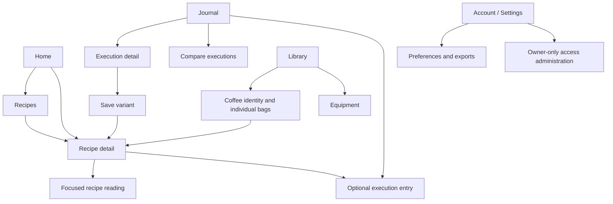

# Screens

## Approved priorities

The primary app action is finding and opening a recipe to brew. Home should prioritize recipe and experiment access, with journal browsing, recent brews, and active coffee bags as secondary content.

Show experiments and Keepers for reuse, with coffee-specific variants as starting points for selected bags. Opening a recipe supports brewing without creating an execution record. Journal views emphasize selected experiments and changed results, with comparisons across related recipes, variants, coffees, and bags. Consumption and equipment-use totals remain secondary summaries of recorded executions.

The user delegates detailed layout and interaction choices to the agent, using the existing mockup as a visual reference. Detailed screen design and human visual validation follow during the UI/UX stage. See the [stage map](../planning/phases.md).

The [user journeys](user-journeys.md) map recipe reading, optional execution capture, variants across bags, ChatGPT entry, and app correction. They provide the flow reference for the screen designs below.

## Design status

The screen inventory and rough layouts below implement #23 for review. They describe intended screens, not a running application. The original [mockup](../../mockups/Painel%20Coffee%202026_%20receitas%20e%20extrações.png) remains the visual reference. Detailed brewing presentation follows in #24 and components/states in #25.

See the [phone-reading design and concrete prototype](phone-reading.md) for #24. Human device validation is pending.

## Target phone

The user intends to use a Samsung S25 Ultra with Brave or Dia. Validate recipe readability and screen-awake behavior on the actual available browser setup during UI/UX.

## Approved UI/UX tasks

| Task | Deliverable |
| --- | --- |
| [#22 — Map recipe selection, brewing, and result-entry journeys](https://github.com/rbonon/coffeelab/issues/22) | Journeys for routine Keeper reading, experiment execution, ChatGPT entry, and app correction; no mandatory logging |
| [#23 — Define screens and responsive visual direction](https://github.com/rbonon/coffeelab/issues/23) | Screen inventory, navigation, recipe-first home, journal/comparison layouts, and use of the existing mockup |
| [#24 — Design recipe reading for the target phone](https://github.com/rbonon/coffeelab/issues/24) | Long-recipe step presentation, readable quantities, English/pt-BR layouts, independent units, and screen-awake behavior |
| [#25 — Define reusable components and validate the UI](https://github.com/rbonon/coffeelab/issues/25) | Design tokens and components, entry forms, empty/partial states, comparison patterns, and user visual validation |

These approved tasks are sub-issues of #3 — UI/UX, assigned to milestone v0 and initially Todo. The user has delegated detailed layout choices. Use rbo-create-change to start a leaf and validate concrete designs at the relevant review points.

## Navigation

Proposed phone navigation uses **Home · Recipes · Journal · Library** as four persistent destinations outside focused recipe reading. Home opens with recipe access. Library groups Coffees & bags and Equipment; Settings is reachable from the account control. Statistics are secondary within Journal. Owner administration appears in Settings only for the owner.

Desktop keeps the same destination names in a left navigation rail, with room for broader lists and adjacent detail panels. The account control gives access to preferences, account exports, and authorized-user management. Detail screens have a clear return to the originating list, retaining its context; browsing and reading do not create execution records.

“Read recipe” is the primary recipe action. “Record a brew” is a separate action available from recipe detail and Journal. It must never become a required Finish step. ChatGPT entry occurs in the connected conversation; Coffee Lab shows and edits the saved records rather than duplicating a chat interface.



## Screen inventory

Identifiers are references for later UI work, not URL or implementation commitments. Entry/edit forms are screen states and can become pages or panels during component design.

| ID / screen | Purpose and primary action | Entry and onward path | Required context and partial states | References |
| --- | --- | --- | --- | --- |
| S01 Home | Find a recipe to brew; open recipe | Start → S02/S03; secondary recent execution → S06; active bag → S10 | Recipe access precedes recent activity and bags. No-data state offers adding a recipe or bag, with no missed-brew indicators | J01, J02; R01, R06, R11 |
| S02 Recipes | Browse/search recipes, filter Experimental/Keeper and category, distinguish base recipes and coffee variants | Home/nav → S03; add/edit → S08 | Cards show available method, status, coffee association and supplied targets. No invented quantities on partial recipes | J01–J04; R06 |
| S03 Recipe detail | Review recipe, choose appropriate variant, read instructions | S01/S02/S10 → S04; optional S07; edit → S08; variant/base links remain visible | Base recipe, coffee association, attribution, supplied quantities/ranges and settings; incomplete steps remain visibly absent | J01–J04; R06, R08 |
| S04 Focused recipe reading | Follow readable steps and targets while brewing | S03 → return to recipe; optional result capture remains available outside the required flow | No app timer or automatic execution. Scale provides timing. Long recipes/no-scroll presentation and awake behavior are #24 | J01, J02; R01, R07 |
| S05 Journal | Find selected recorded executions; filter and compare | Nav → S06/S13; add → S07; filtered PDF/export → S15 | Filters cover coffee, bag, base/variant, category, date, equipment. Empty results allow clearing filters; empty journal is valid | J02, J03, J05, J06; R08–R13 |
| S06 Execution detail | Review snapshot, actual results, observations and photos | S05/recent → S07 edit, S08 save variant, S13 comparison | Bag/date/category, known source links, distinct planned and actual data. Text-only results are complete; historical snapshot survives source deletion | J02, J03, J06; R08, R10–R12, R14 |
| S07 Execution entry/edit | Save available execution data or enrich an existing result | S03/S05/S06 → saved S06 | Only bag, category and date required. Optional recipe, measurements, photos and tasting. Casual untracked mode can use selected recipe quantities as actuals | J02, J05, J06; R08–R10, R12 |
| S08 Recipe/variant entry/edit | Save a base recipe or reusable coffee-specific variant | S02/S03/S06 → S03 | Base minimum name/category. Variant minimum name/base/coffee; inherited category; origin execution retained when applicable. Experimental default, optional Keeper choice | J03, J05, J06; R06 |
| S09 Library | Select Coffees & bags or Equipment | Nav → S10/S12 | Keep categories distinct; add action belongs to selected library | J04, J06; R04, R05 |
| S10 Coffees & bags | Find coffee identity, inspect its purchased bags and relevant variants | S09/S01 → S11 edit/add, S03 variant, S05 bag/coffee history | Identity details above separate bag records; active/archived distinction. Name-only bag remains usable | J04–J06; R04, R06, R14 |
| S11 Coffee/bag entry/edit | Save identity or bag details/photos | S10 → S10 | Name minimum; optional association, roast/purchase/manufacture/best-before, price/currency, weight, storage. Manufacture and roast labels distinct; original photos retained | J04–J06; R04 |
| S12 Equipment list/detail/edit | Maintain actual equipment and settings context | S09 → detail/edit; related history → S05 | Name/type minimum; model, notes and photos optional. Preserve grinder-specific notation | J05, J06; R05, R14 |
| S13 Compare executions | Inspect related settings and results | S05/S06 → referenced S06 or S08 variant | Each selected record identifies coffee, bag, base/variant. Compare planned/actual settings, observations and photos; preserve missing values | J03, J05; R06, R08, R11, R12 |
| S14 Recorded statistics | Summarize filtered journal records | S05 → matching S05/S06 | Counts, prepared coffee, grounds, time trends, methods/equipment and enjoyment distribution; no comprehensive consumption claim | R09–R11 |
| S15 Exports | Export recipe, filtered journal PDF, or full account | S03/S05/account → download outcome | Recipe/journal PDF photos default on, option omit; current filters, language/units respected. Full export includes original photos | U08; R03, R13 |
| S16 Sign-in and account recovery | Reach the authorized private account | Signed-out → S01; access failure → clear recovery/access outcome | Email/password and Google, secure same-email account linking; exact recovery and revocation interactions require security design | U09; R02 |
| S17 Preferences | Choose language and independent units | Account → return to current app context | English/pt-BR; g/oz and °C/°F independent. Original recipe/notes language retained | U09; R03 |
| S18 Owner access management | Manage authorized emails | Owner Settings → saved access state | Owner-only; removal blocks access while retaining data. Reauthorization restores access; active-session policy pending security design | U09; R02 |

Archive/restore actions belong to relevant coffee, bag, equipment and recipe details. Archived items leave everyday selection but remain searchable. Permanent deletion is an explicit action; source deletion preserves execution snapshots (R14). Component-level confirmation and recovery details belong to #25 and later security/technical work.

### Journey coverage

| Journey | Screen path |
| --- | --- |
| J01 Keeper reading | S01 → S02/S03 → S04 → leave without a record |
| J02 experiment/results | S03 → S04 → optional S07 → S06; later enrichment via S06 → S07 |
| J03 successful variant | S05 → S06/S13 → S08 → S03 |
| J04 new bag reuse | S09 → S10/S11 → S03 relevant variant → S04; optional S07 with new bag |
| J05 ChatGPT entry | External authorized chat → explicit save → record available in S02/S03, S05/S06, S10 or S12; correction through corresponding app form |
| J06 app entry/correction | Relevant list/detail → S07/S08/S11/S12 edit state → saved detail |

## Rough responsive layouts

These diagrams show content order and grouping. Dimensions, typography, controls and spacing need visual implementation and user validation. Example names indicate record types, not imported data. Ordinary browsing can scroll; the focused brewing view's no-scroll requirement is handled in #24.

### Home — phone

```text
┌──────────────────────────────┐
│ Coffee Lab          Account  │
│ Find a recipe to brew        │
│ [Search recipes…]            │
│ [Keepers] [Experiments]       │
│ Recipe / variant cards       │
│  Name · method · status      │
│  Coffee, if associated       │
│  [Open recipe]               │
│ [See all recipes]            │
│ Recent recorded results      │
│ Active bags                  │
│ Home Recipes Journal Library │
└──────────────────────────────┘
```

A compact header replaces the mockup's large hero so recipe access stays prominent. Recent results and bags are secondary sections and may be empty without an incomplete-state warning.

### Home — desktop

```text
┌──────────┬─────────────────────────────┬──────────────────┐
│Coffee Lab│ Find a recipe…              │ Account          │
│Home      │ Keepers / Experiments       │                  │
│Recipes   │ Recipe cards in roomy grid  │ Active bags      │
│Journal   │ Name, method, coffee/status │                  │
│Library   │ Open recipe                 │ Recent results   │
│          │                             │                  │
│Settings  │ See all recipes             │                  │
└──────────┴─────────────────────────────┴──────────────────┘
```

### Recipe detail — phone

```text
┌──────────────────────────────┐
│ Back             Edit / More │
│ Recipe name · status         │
│ Base recipe ↔ coffee variant │
│ Optional photo / attribution │
│ Dose · water/yield · ratio    │
│ Temperature · grind, if known│
│ [Read recipe]                │
│ Steps / targets preview      │
│ Source and adaptation notes  │
│ Related recorded results     │
│ [Record a brew]  (optional)   │
└──────────────────────────────┘
```

“Read recipe” opens S04 without starting a timer or a record. The focused view is designed separately. Missing optional targets do not become zeros or fabricated guidance. Variant choice shows the associated coffee and source base recipe; choosing the actual bag is needed when recording an execution.

### Recipe detail — desktop

```text
┌──────────┬────────────────────────────┬────────────────────┐
│Navigation│ Name · status · base/coffee│ Quantities / ranges│
│          │ Optional photo            │ Method-based ratio │
│          │ Instructions and targets  │ Equipment / grind  │
│          │ Sources / adaptation      │ [Read recipe]      │
│          │ Related recorded results  │ [Record a brew]    │
│          │                           │ Edit / export      │
└──────────┴────────────────────────────┴────────────────────┘
```

### Journal and comparison — phone

```text
┌──────────────────────────────┐
│ Journal            Add brew  │
│ Search / Filters             │
│ Active filters · Clear       │
│ Recorded execution cards     │
│  Date · coffee · bag          │
│  Base / variant · method     │
│  Observation / rating if any │
│ [Compare selected]           │
│ Statistics / Export PDF      │
│ Home Recipes Journal Library │
└──────────────────────────────┘
               ↓ compare
┌──────────────────────────────┐
│ Back · Selected executions   │
│ Parameter group: Quantities  │
│ Execution A · coffee / bag   │
│ Planned …  Actual …          │
│ Execution B · coffee / bag   │
│ Planned …  Actual …          │
│ Next groups: Grind / Notes   │
│ [Open A] [Open B]             │
└──────────────────────────────┘
```

Phone comparison groups values by topic and repeats each execution's identity so the user can compare without a wide compressed table. Missing observations read as absent, not poor scores. Selection limits and exact comparison controls remain component design work; no new product limit is introduced here.

### Journal and comparison — desktop

```text
┌──────────┬─────────────────────────────────────────────────┐
│Navigation│ Journal · search · filters · Add brew           │
│          │ Date | Coffee / bag | Recipe / variant | Result │
│          │ Recorded rows with optional photo/observation   │
│          │ Compare selection · Statistics · Export PDF     │
├──────────┼─────────────────┬───────────────┬───────────────┤
│Comparison│ Parameter       │ Execution A   │ Execution B   │
│          │ Coffee / bag    │ Identity      │ Identity      │
│          │ Recipe / variant│ Source        │ Source        │
│          │ Planned targets │ Supplied data │ Supplied data │
│          │ Actual settings │ Supplied data │ Supplied data │
│          │ Notes / photos  │ Observations  │ Observations  │
│          │                 │ Open record   │ Open record   │
└──────────┴─────────────────┴───────────────┴───────────────┘
```

Planned and actual values have explicit labels rather than being merged into one value. Coffee identity, individual bag and recipe variant stay visible. Comparison starts from recorded examples; AI conclusions happen in ChatGPT with references to those records and the limits of the selected sample.

## Visual direction from the mockup

Retain warm coffee-brown accents for principal actions, off-white/light surfaces, softly separated cards, dark readable text, restrained icons and coffee photography. Use color with labels for status and rating. Prefer useful content over decorative hero height, especially on the phone. Actual photos are optional; a record must remain well composed without one.

| Mockup element | Direction for current design |
| --- | --- |
| Four large home shortcuts and coffee hero | Put recipe search/opening first; keep library and journal easy to reach |
| Compact quantity tiles | Retain legibility; allow exact/range targets and method-specific ratio labels |
| Recipe and extraction photos | Retain when supplied; do not fabricate owned equipment or historical photos |
| Timer ring, Pause and Finish | Replace with #24's scale-timed instruction reading; no app timer or forced completion |
| Required coffee/grind/total-time form | Execution minimum is bag/category/date; grind and time remain optional |
| Overall 1–5 sensory score | Four optional intensity scales plus optional Didn't enjoy / Okay / Enjoyed |
| Sensory defaults and charts | Missing scores stay absent; no default observed scores or overall-score average |
| Mockup dates, roast details and example measurements | Illustrative only; historical import uses verified source records |

### Responsive and accessible constraints

- Content order follows the same priorities at every width. Stack columns when content no longer fits; choose concrete breakpoints during implementation from actual content, not the phone's physical pixel count.
- Keep text and touch controls readable and reachable, with clear focus, keyboard access, labels and sufficient contrast. #25 defines concrete component sizes, tokens and interaction states.
- English and pt-BR text must wrap naturally without clipping important actions. Language selection does not determine units. Each quantity labels its basis and unit; temperature and weight preferences convert independently.
- Recipe and variant cards can show partial data without blank compulsory tiles. Text-only tasting is a complete result. Optional ratings remain unset until supplied; clear/omit behavior is part of component design.
- Failed saves, unavailable photos, empty search results and access denial need clear states. Detailed recovery and retry rules require technical design; wireframes do not promise that uploads or writes already work.

## Review and handoffs

The proposed choices for review are the four phone destinations, recipe-first home, a separate reading action, and comparison grouped by parameter on phones versus columns on desktop. They are delegated design proposals pending the user's review of this artifact.

#24 owns focused reading for all five categories, long instructions without scrolling during execution, and actual Samsung S25 Ultra browser/screen-awake validation. #25 owns reusable components, tokens, detailed entry and empty/partial/error states, and human visual validation. No Next.js, Tailwind, authentication provider, or database is selected by these diagrams.

## Browsing prototype — #25 in progress

The [prototype](../prototypes/recipe-reading.html) now has Home/Recipes/Journal/Library navigation (Início/Receitas/Diário/Biblioteca in pt-BR). Navigation is hidden during focused reading and Settings. Recipes open the full schedule and return to the originating screen. App navigation creates browser history entries; native Back/Forward restores the previous app view, including record detail and Settings. Redundant top Back buttons were removed at the user’s request. Reload restores the current history entry. Back from the initial Home entry may leave the prototype normally. Journal retains only the two named Hoffmann executions, with actual water/time and original observations where known. Library provides coffee/equipment details and explicitly provisional historical bag context; missing roast dates remain missing. Display names identify the executions; legacy codes and aliases are not shown.

Journal rows use small, single-color outline happy/neutral/sad face rating icons with accessible labels; execution details retain the text rating. Implementation patterns currently shared are bottom navigation, light list rows, label/value detail fields, source-safe text rendering, recipe preparation and schedule. Existing CSS custom properties supply the warm palette. Entry forms, optional ratings, comparison and empty/error state designs are still pending, along with human review of browsing surfaces. #25 depends on the unmerged #24 prototype; this is not a completed UI/UX stage or a live application.

A06 now includes the real user-supplied final-extraction photo. Record-photo previews preserve the whole image and open an enlarged dialog. Browser Back closes the photo to the same detail view; the caption and accessible description identify it. Other records have no invented photos. The same photo component can display later coffee/equipment attachments.

Execution detail now shows a separate evaluation summary and observations for each retained brew. Discussed hypotheses/recommendations and original shared tasting text are expandable, preserving the distinction between observations and interpretations. The source dialogue is retained under `docs/vision/hoffmann-comparacao-avaliacao.md`.
