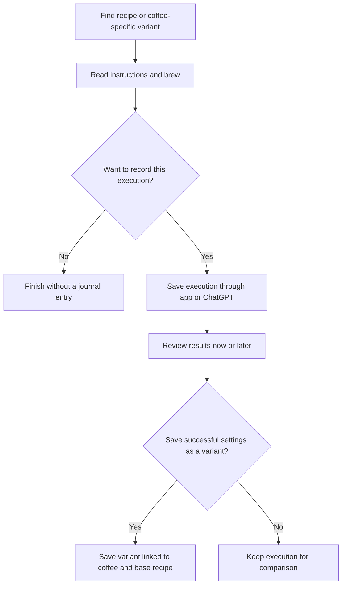

# User journeys

These journeys translate the approved [requirements](requirements.md) and [user stories](user-stories.md) into end-to-end actions for [UI/UX task #22](https://github.com/rbonon/coffeelab/issues/22). Screen layouts follow in #23 and phone recipe reading in #24. They describe desired product behavior; the application and ChatGPT integration are still to be implemented.

## Journey map

| Journey | Starts with | Successful exit | Traceability |
| --- | --- | --- | --- |
| J01 — Read and brew a Keeper | A familiar recipe to repeat | Coffee brewed; no record required | R01, R06, R07; U02, U03 |
| J02 — Run and record an experiment | An experiment or changed result worth keeping | A self-contained execution, optionally enriched later | R06, R08–R10; U02–U05 |
| J03 — Save a successful variant | A recorded execution with useful adjustments | A reusable variant linked to coffee, base recipe, and execution | R06, R08, R11, R12; U02, U07 |
| J04 — Start a new bag | Another purchase of a known coffee | Relevant saved settings ready to use with the new bag | R04, R06, R08, R14; U02, U06 |
| J05 — Discuss and save through ChatGPT | A recipe idea, photos, or a question about history | Requested valid content saved and available in Coffee Lab | R04–R06, R08, R10–R12; U01, U04, U06, U07 |
| J06 — Enter or correct in the app | A new record or something to amend | A valid record saved with optional details preserved | R01, R04–R06, R08–R10, R14; U04–U06 |

The decision branches describe user choices, not mandatory completion prompts. Every journey uses the signed-in account's private data. Language and weight/temperature preferences apply independently throughout (R02, R03; U09). Recipe and tasting text keeps its original language.

## J01 — Read and brew a Keeper

**Starting context.** The user opens Coffee Lab on the phone intending to repeat a familiar recipe. A Keeper is available, possibly as a coffee-specific variant.

1. Find the recipe through the primary recipe access, optionally choosing a variant relevant to the coffee or bag.
2. Open its instructions and supplied quantities, equipment settings, and targets. An incomplete recipe shows only the information available.
3. Follow readable steps with screen-awake support and use the scale's timer. Pour additions and cumulative targets stay distinct; ratios use the method-appropriate basis.
4. Finish brewing and leave the recipe whenever desired.

**Saved data and exit.** Reading alone creates no execution. There is no completion task, missing journal entry, or obligation to rate the cup. User-selected Keeper status does not change automatically based on repetition.

**Alternate paths.** An interesting change or different result can lead to J02. Before brewing, an adjusted experiment can be updated or saved as a new experiment through the app or ChatGPT. Existing execution snapshots stay intact.

**Verification dependency.** The Samsung S25 Ultra's available Brave or Dia setup, long-recipe presentation without scrolling during execution, and screen-awake interruptions require #24 validation. This journey does not establish that browser support has been proved.

## J02 — Run and record an experiment

**Starting context.** The user selects an experiment, changes a recipe, or wants to retain a different result from a Keeper. A bag, brewing category, and date identify the execution.

1. Open the recipe or variant and select the bag used. Review planned quantities and steps, adjusting settings for this execution as needed.
2. Brew from the instructions, timing on the scale. Execution-specific adjustments do not silently edit the base recipe.
3. Choose to record the execution through the app or J05. Supply the available dose, water, bypass, finished yield, temperature, grind setting, elapsed time, and photos of the bed, scale, or drink.
4. Save with at least bag, brewing category, and date. When a recipe is known, preserve its planned snapshot separately from actual values and adjustments.
5. Add tasting observations now or later. Free text alone is complete. Acidity, sweetness, body, and bitterness intensity scales (1–5) and the three-choice enjoyment rating are independently optional.
6. Reopen the saved execution from the journal to review or enrich it, compare related records, or continue to J03.

**Saved data and exit.** One recorded execution retains its bag, known equipment/settings, recipe snapshot, actual data, and supplied observations/photos. Later source edits or deletion leave the saved snapshot intact. Missing measurements and ratings remain missing; filter brews need no finished-drink measurement.

**Alternate paths.** Saving without tasting notes is a successful exit, with no later completion requirement. The user may also leave after brewing without recording, as in J01. For a completed casual/untracked brew, select the bag, category, date, and optional standard recipe. That recipe's supplied quantities become actuals in ordinary statistics, retaining its snapshot and the untracked designation without estimate labels. No sensory result is invented; unavailable recipe quantities stay empty.

**Recovery.** Missing minimum fields prevent a valid save and are identified for correction. Failed writes or photo uploads must surface their outcome; reliable retry and partial-upload handling remain technical design work. A success message must reflect what was actually saved.

## J03 — Save a successful variant

**Starting context.** The user reviews an execution and decides its adjustments are worth repeating. The journal can filter by coffee, bag, base recipe, variant, method, date, and equipment.

1. Inspect the execution's planned and actual settings and observations, optionally comparing related records in the app or discussing them with ChatGPT.
2. Choose the settings to reuse. For example, a Hoffmann execution using 1:17 rather than 1:15 for Stardust can inform a Stardust variant. This is an illustrative workflow, not an additional historical brew.
3. Request a variant save through the app or explicitly in ChatGPT. Supply its name, base recipe, and coffee identity; inherit the brewing category and retain relevant equipment/settings and the originating execution.
4. Save and open the resulting variant for later use. Its default status is Experimental; the user may select Keeper when satisfied.

**Saved data and exit.** A reusable coffee-specific variant links to its base, coffee identity, and originating execution. Saving it preserves the base recipe and earlier execution snapshots. Merely comparing records or receiving an AI suggestion saves no variant.

**Alternate paths and recovery.** Keep the execution alone if no variant is wanted. If the bag has no associated coffee identity yet, resolve or create that identity before completing the variant's required association. Missing minimum fields are corrected before save. Comparisons expose other changed parameters and missing observations; they do not establish causation or complete consumption coverage.

## J04 — Start a new bag of the same coffee

**Starting context.** A new bag is purchased, and the coffee may already have a useful variant from an earlier bag.

1. Add the individual bag through J05 or J06. A name alone is sufficient; photos, roast and purchase details, and other fields can follow later. Manufacture date remains distinct from roast date.
2. Associate it with the existing coffee identity when it is the same coffee. Keep separate bags and their roast/purchase details distinct.
3. Find the saved coffee-specific variant and use its settings as a suggested starting point. Review and adjust them for the new bag rather than assuming identical results.
4. Brew through J01 or J02. When recording, identify the new bag and preserve this execution's own snapshot and settings.
5. When an old bag is finished, manually archive it if desired. Its history remains searchable and it can be restored.

**Saved data and exit.** The new bag is independent of earlier purchases. Reusing a variant alone does not create an execution or modify earlier results. Any recorded brew points to the actual bag used.

**Alternate paths and recovery.** Without a suitable variant, choose a base recipe or develop an experiment through J05. A name-only bag can remain partial; resolving coffee identity is necessary when using the cross-bag variant relationship. Archived bags are available through history/search rather than everyday selection. No remaining-inventory deduction is implied.

## J05 — Discuss, prepare, and save through ChatGPT

**Starting context.** ChatGPT is connected to the user's authorized Coffee Lab account. The user has a recipe idea, external material, photos to interpret, or a question about recorded results.

1. Discuss the intended outcome. ChatGPT can retrieve the account's coffees, bags, equipment, recipes, executions, notes, photos, and relationships. External research occurs in the conversation.
2. Prepare the desired entry or adjustment. Examples include adapting a sourced recipe for roast/servings, extracting bag details from multiple packaging photos, or reading a scale photo and retaining a free-text tasting description.
3. Check and refine the discussed content in the chat. Unknown values remain missing. Proposed sensory ratings are optional and preserve the original tasting text.
4. Say “save this” or otherwise explicitly request the agreed write. That authorizes immediate saving of valid discussed content, including photos and any agreed inferred values, without another Coffee Lab approval.
5. Confirm the save outcome in the conversation. Open the resulting record in Coffee Lab to read, brew, compare, or correct it when desired.

**Saved data and exit.** The explicit request saves the relevant recipe, variant, bag, equipment, execution, or observation update under the authorized account, subject to the same validation as app entry. Discussion and recommendations alone create no record. Experimental is the recipe/variant default unless the user selects Keeper.

**Alternate paths and recovery.** An analysis-only conversation ends without a write. A question about Hoffmann results across coffees can cite the supporting executions and distinguish parameter changes and missing observations. If minimum fields or the intended target record are unresolved, resolve them in the chat before saving. Failed validation, access, or photo transfer is surfaced rather than represented as a successful complete save. The app's direct forms remain available through J06.

**Technical dependency.** MCP is proposed, not yet verified. ChatGPT authorization, structured writes, original-photo transfer, and retries without duplicates require an early technical check. Transfer failures must identify unavailable photos; exact retry and partial-save behavior remain to be designed. Historical source gaps are separately recorded in the [source coverage report](../vision/README.md#historical-pour-over-source) and do not prove photo-transfer support.

## J06 — Enter or correct in Coffee Lab

**Starting context.** The user wants to add a record directly or correct an existing bag, coffee, equipment item, recipe, variant, or execution.

1. Open the relevant entry form or existing record. Use the agreed [field minimums](requirements.md#agreed-field-matrix), showing supplied optional details without requiring them.
2. Enter or amend the intended values and attach available photos. Keep coffee identity distinct from bag details, packaging descriptors distinct from tasting observations, and execution actuals distinct from planned targets.
3. Save. Validation identifies missing required or invalid input; valid app entry produces equivalent records to the same AI input.
4. Read the saved result and return to recipe viewing, the journal, or the relevant library. An execution can be enriched later without imposing a completion task.

**Saved data and exit.** The selected record contains the valid changes. Editing a source recipe does not rewrite saved execution snapshots. Explicit correction of an execution changes that execution's entered data while preserving the distinction between planned and actual values.

**Alternate paths and recovery.** Leave without requesting a save to exit without an intended write; exact unsaved-edit interactions belong to screen design. A text-only tasting entry is complete without rating placeholders or warnings. Archived records can be restored; permanent deletion is an explicit action and leaves existing brew snapshots intact. Save/upload failures must surface their outcome, with retry behavior determined in technical design.

## Review checks and remaining dependencies

- Recipe access is primary. J01 is complete without logging, while J02 provides optional capture and later enrichment.
- All six paths preserve approved minimum fields, optional sensory input, coffee/bag relationships, and self-contained execution history.
- J03 and J04 carry useful settings across bags without automatically promoting Keepers or changing historical data.
- J05 uses the single conversational save gate; J06 supplies independent app entry and correction.
- Journal comparisons and statistics summarize selected recorded executions. Export/PDF, account administration, and backup requirements remain in R02, R13, and R15; these are outside this journey task's primary flows.
- Concrete navigation, controls, empty/partial states, bilingual layouts, and phone reading behavior are handled by #23–#25. Infrastructure, secure account linking/access revocation, MCP compatibility, and write/upload recovery remain [later-stage follow-ups](../planning/open-questions.md).

Human review should confirm that these paths match how the user intends to brew, selectively save results, and reuse learned settings. This document awaits that review; it does not constitute phone or integration validation.
